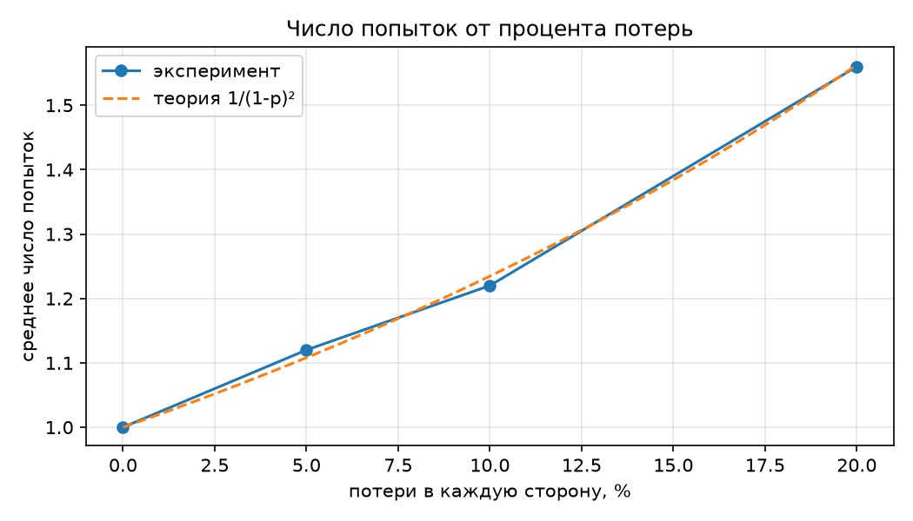
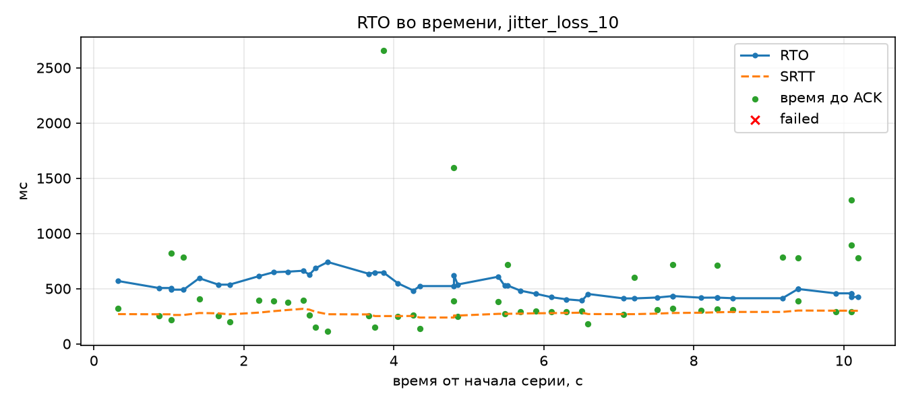

# Отчёт по надёжной доставке поверх UDP

## Архитектура

### Какие команды сделаны надёжными и почему
Игра пошаговая: каждый приказ юниту (`UNIT_MOVE`, `UNIT_ATTACK`) отдаётся один
раз и следующим пакетом не перекрывается, как поток позиций в шутере. Потерянный
приказ означает, что юнит пропустит ход, поэтому оба приказа надёжны.
Повторно применённый `UNIT_ATTACK` нанёс бы двойной урон, отсюда окно
дедупликации на сервере. `PING`/`PONG` ненадёжны: их потеря — часть
измерения.

### Формат ACK и requiresAck
Заголовок 8 байт, `requiresAck` — байт 7. `ACK` (тип 5) несёт подтверждаемый
номер в заголовке и в payload (u16) и сам подтверждения не требует. Подробно —
[Protocol_Specification.md](Protocol_Specification.md), разделы 3, 4.4 и 9.

### Компоненты
| Модуль | Ответственность |
|---|---|
| `protocol` | формат v2, сериализация и проверка ACK |
| `reliability/ReliableChannel` | учёт неподтверждённых пакетов, без сокетов |
| `reliability/AdaptiveTimeout` | RTO по Джекобсону |
| `reliability/DedupWindow` | окно обработанных номеров на сервере |
| `reliability/delivery_log` | журнал доставки `reliability_samples.csv` |
| `client/OrderBook` | игровой слой: оптимистичный показ, откат при недоставке |

### Формула RTO и константы
RTTVAR = 0.75·RTTVAR + 0.25·|SRTT − RTT|; SRTT = 0.875·SRTT + 0.125·RTT;
RTO = clamp(SRTT + 4·RTTVAR, 100, 3000) мс; до первого замера 1000 мс;
при первом замере RTTVAR = RTT/2. max_attempts = 5.
Замеры: PING/PONG (5 при старте) и время до ACK только у пакетов,
подтверждённых с первой попытки (правило Карна).

## Результаты
Условия — `docs/Experiment_Config.md`, сырые данные — `docs/reliability_samples.csv`,
таблица получена `tools/plot_reliability.py`. В каждой серии 50 приказов
(25 `UNIT_MOVE` и 25 `UNIT_ATTACK`) с интервалом 200 мс; потери и задержка
Clumsy действуют в обе стороны. Avg RTO — среднее значение RTO в момент
завершения приказа (ACK или уход в failed).

| Серия | Отправлено | Доставлено с 1-й попытки | Retransmit total | Failed | Avg attempts | Avg RTO, мс | Time-to-ACK, мс |
|---|---:|---:|---:|---:|---:|---:|---:|
| baseline | 50 | 50 | 0 | 0 | 1.00 | 100.0 | 0.41 |
| loss_5 | 50 | 45 | 6 | 0 | 1.12 | 100.0 | 14.20 |
| loss_10 | 50 | 40 | 11 | 0 | 1.22 | 100.0 | 25.49 |
| loss_20 | 50 | 33 | 28 | 1 | 1.56 | 100.0 | 53.75 |
| delay_100_loss_5 | 50 | 42 | 9 | 0 | 1.18 | 298.9 | 300.82 |
| jitter_loss_10 | 50 | 37 | 18 | 0 | 1.36 | 513.7 | 473.08 |

Итоговое значение RTO в конце серии и дополнительные показатели:

| Серия | Final RTO, мс | RTO min–max, мс | Final SRTT, мс | Медиана Time-to-ACK, мс | Max Time-to-ACK, мс | Распределение попыток (попыток: приказов) |
|---|---:|---:|---:|---:|---:|---|
| baseline | 100.0 | 100–100 | 0.44 | 0.34 | 1.78 | 1: 50 |
| loss_5 | 100.0 | 100–100 | 0.74 | 0.76 | 211.71 | 1: 45, 2: 4, 3: 1 |
| loss_10 | 100.0 | 100–100 | 0.77 | 0.74 | 222.48 | 1: 40, 2: 9, 3: 1 |
| loss_20 | 100.0 | 100–100 | 0.67 | 0.81 | 441.76 | 1: 33, 2: 10, 3: 5, 5: 2 |
| delay_100_loss_5 | 287.1 | 267.8–378.7 | 249.45 | 250.18 | 844.10 | 1: 42, 2: 7, 3: 1 |
| jitter_loss_10 | 424.3 | 391.7–741.0 | 299.27 | 308.87 | 2653.80 | 1: 37, 2: 10, 3: 2, 5: 1 |

Сравнение среднего числа попыток с теорией. Попытка успешна, только если
дошли и приказ, и его ACK: вероятность (1 − p)², ожидаемое число попыток
1 / (1 − p)², вероятность исчерпать 5 попыток (1 − (1 − p)²)⁵.

| Серия | p | Avg attempts, теория | Avg attempts, факт | Ожидаемо failed на 50 | Failed, факт |
|---|---:|---:|---:|---:|---:|
| baseline | 0 | 1.00 | 1.00 | 0 | 0 |
| loss_5 | 0.05 | 1.11 | 1.12 | < 0.01 | 0 |
| loss_10 | 0.10 | 1.23 | 1.22 | 0.01 | 0 |
| loss_20 | 0.20 | 1.56 | 1.56 | 0.30 | 1 |

Дубликаты на сервере (`server.log`, строки `duplicate`; серия определена
по порту клиента, а номера совпадают с переотправленными приказами из CSV):

| Серия | Дубликатов | Номера | HP цели после серии |
|---|---:|---|---:|
| baseline | 0 | — | 975 |
| loss_5 | 3 | 10, 16, 19 | 975 |
| loss_10 | 5 | 10, 16, 19, 20, 21 | 975 |
| loss_20 | 9 | 8, 8, 11, 17, 18, 25, 27, 38, 49 | 975 |
| delay_100_loss_5 | 3 | 14, 23, 26 | 975 |
| jitter_loss_10 | 4 | 12, 12, 22, 22 | 975 |

Сервер перезапускался перед каждой серией, атака снимает 1 HP, поэтому
HP 975 = 1000 − 25 означает, что каждая из 25 атак применена ровно один раз.

## Графики

## Анализ
- **Адаптивный RTO против фиксированных 1000 мс из ПР №2.** В сериях на
  loopback без задержки SRTT меньше 1 мс, и RTO всё время прижат к нижней
  границе 100 мс: потерянный приказ повторяется через 0.1 с, а не через 1 с.
  Поэтому даже в loss_20 среднее время до ACK — 54 мс. С ростом задержки RTO
  вырос вслед за RTT: в delay_100_loss_5 он держался в 268–379 мс при SRTT
  около 250 мс, в jitter_loss_10 — в 392–741 мс, а запас 4·RTTVAR покрывал
  разброс задержки. Фиксированная секунда в этих сериях дала бы в 2–10 раз
  более долгое ожидание повтора.
- **Серия loss_20.** Среднее число попыток 1.56 совпало с теоретическим
  1/0.64 ≈ 1.56. Два приказа дошли до пятой попытки: seq 8 подтвердился на
  пятой, seq 38 (`UNIT_MOVE` в (6, 1)) ушёл в failed. Вероятность этого —
  0.36⁵ ≈ 0.6% на приказ, около 0.3 приказа на серию, так что один failed
  укладывается в ожидание. При этом в `server.log` есть дубликат seq 38, и
  клиент получил текстовый ответ `UNIT_MOVED unit=1 position=(6, 1)`: сервер
  приказ применил, потерялись все пять ACK. Это наглядный пример того, что
  «не доставлен» на клиенте означает «не подтверждён», а не «не применён».
- **Серия jitter_loss_10.** Throttle в Clumsy задерживает пакеты пачками, и
  отдельные ответы приходили намного позже RTO: максимальное время до ACK —
  2654 мс (seq 12, подтверждён на пятой попытке). На графике такие точки лежат
  выше линии RTO: это приказы, которые отправлялись повторно, и их время до
  ACK считается от первой отправки. Сервер получил seq 12 и seq 22 по три
  раза: часть повторов оказалась лишней, потому что исходный пакет или его
  ACK был задержан, а не потерян. Правило Карна не дало этим замерам
  исказить SRTT, а окно дедупликации — применить приказы повторно. Отказов в
  серии нет: пяти попыток хватило даже при задержке в 2.6 с.
- **Окно дедупликации.** Во всех сериях с потерями сервер получал повторы
  уже обработанных приказов (от 3 до 9 за серию) и отвечал на них ACK, не
  применяя эффект повторно: HP цели после каждой серии ровно 975. Без окна
  каждый такой повтор `UNIT_ATTACK` нанёс бы лишний урон. Все номера
  дубликатов совпадают с приказами, у которых в CSV `attempts > 1`.

## Найденная при проверке ошибка
В первом прогоне все 10 приказов ушли в failed, а HP цели снизилось на 25 за
5 атак. Причина — `parsePacket` читал и проверял `requiresAck`, но не
записывал его в `PacketHeader`, и поле всегда было `false`. Сервер считал
каждый приказ ненадёжным: не отправлял ACK и не проверял окно. Ошибку ловит
тест «Unit orders require ACK, PING does not» в `tests/protocol_tests.cpp`.

## Ответы на вопросы

1. **Почему фиксированный тайм-аут из ПР №2 непригоден для повторной передачи?**
   Тот тайм-аут решает, когда записать замер в потери, и должен быть с
   запасом. Для повторов он плох в обе стороны: на loopback (RTT < 1 мс)
   потерянный приказ ждал бы 1 с вместо 0.1 с, а при всплеске задержки выше
   1 с начались бы ложные повторы. Адаптивный RTO в эксперименте менялся от
   100 до 741 мс вслед за сетью.
2. **Как рассчитывается RTTVAR и почему множитель 4?** RTTVAR — сглаженное
   среднее отклонение замера от SRTT с β = 0.25. Множитель 4 даёт запас
   примерно в три стандартных отклонения: почти все нормальные ответы
   приходят раньше RTO. С множителем 1 каждый чуть запоздавший ACK при
   джиттере вызывал бы ложный повтор.
3. **Почему ACK не требует собственного подтверждения?** ACK уходит с
   `requiresAck = 0`, а парсер отклоняет ACK с флагом 1. Потерянный ACK
   восстанавливается повтором исходного пакета: сервер получит его снова и
   снова пришлёт ACK (в эксперименте так произошло 24 раза). Подтверждение
   ACK породило бы бесконечную цепочку.
4. **Как сервер отличает повтор от нового пакета с тем же эффектом?** По
   `sequenceNumber` в окне конкретного клиента (адрес:порт). Повтор — те же
   байты с тем же номером. Новая атака по той же цели получает новый номер и
   применяется: в каждой серии 25 атак по юниту 2 сняли ровно 25 HP.
5. **Что должно произойти, если `UNIT_ATTACK` окончательно не доставлен?**
   `OrderBook` отменяет атаку на клиенте, сообщает игроку, и юнит может
   атаковать в этом ходу заново, уже новым приказом. Но «не доставлен»
   значит «не подтверждён»: в loss_20 сервер применил приказ seq 38, хотя
   клиент записал его в failed. Поэтому окончательное состояние клиент
   должен брать из синхронизации с сервером, а не из своего предположения.
6. **Почему не все команды стоит делать надёжными?** При частой отправке
   позиции каждый следующий пакет делает предыдущий ненужным, а повтор
   устаревшей позиции только вредит и забивает канал. В нашей пошаговой игре
   `UNIT_MOVE` — разовый приказ, а не поток позиций, поэтому он надёжный.
   `PING` ненадёжен: повтор исказил бы измерение.
7. **Как связаны результаты ПР №2 с параметрами повторов?** SRTT из ПР №2 —
   то же сглаживание с α = 0.125, на котором построен RTO. Джиттер определяет
   RTTVAR и тем самым запас RTO: в jitter_loss_10 RTO был на 110–470 мс выше
   SRTT, в delay_100_loss_5 (задержка без джиттера) — на 27–162 мс. Доля потерь определяет
   ожидаемое число попыток 1/(1 − p)² и выбор `max_attempts`.

## Вывод
Надёжная доставка поверх UDP работает: во всех шести сериях доставлено 299
приказов из 300, единственный failed пришёлся на loss_20 и укладывается в
теоретическую вероятность 0.6% на приказ. Среднее число попыток совпало с
моделью 1/(1 − p)² с точностью до 0.01. Адаптивный RTO подстраивается под
сеть: на loopback он держится на нижней границе 100 мс, при задержке 100 мс в
каждую сторону поднимается до 270–380 мс, при джиттере — до 740 мс. Окно
дедупликации отсекло все 24 повтора, пришедших на сервер, и ни одна атака не
применилась дважды. Главное ограничение — клиент не может отличить
непримененный приказ от применённого с потерянными ACK; для игры это значит,
что после недоставки нужна синхронизация состояния с сервером.
